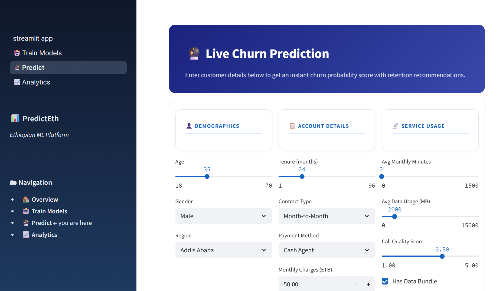
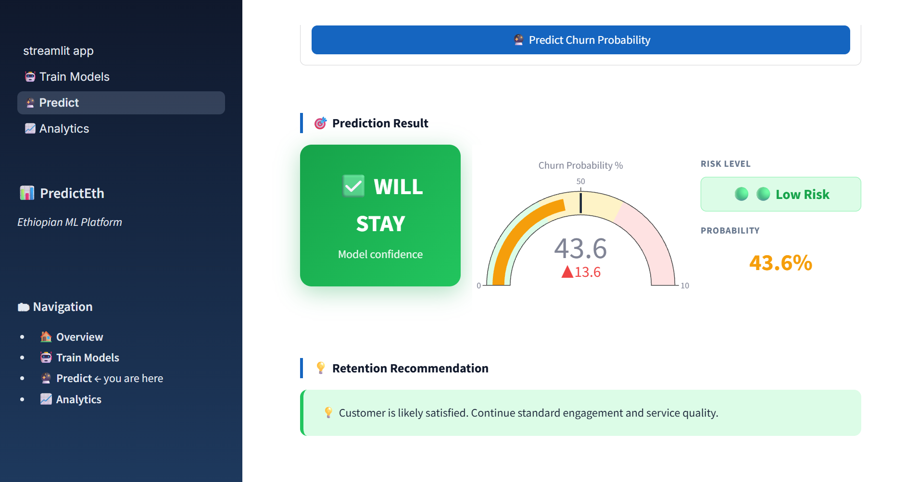
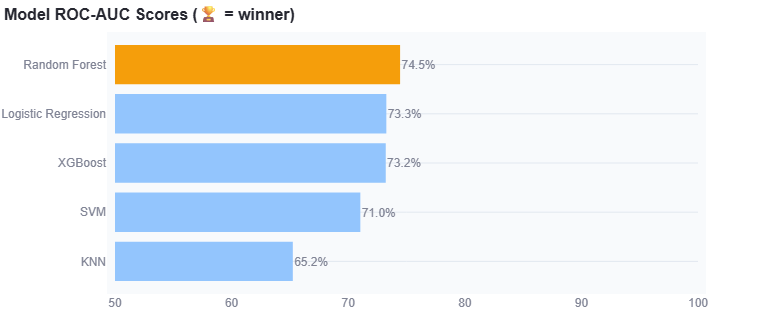
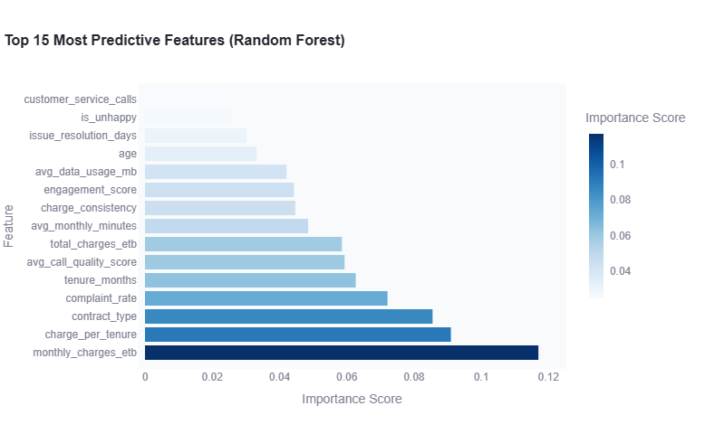

# 📊 PredictEth — Ethiopian Telecom Churn Prediction


[](https://predicteth.onrender.com)

> End-to-end ML pipeline predicting customer churn for Ethiopian telecom companies. Trained on 10,000 synthetic customers reflecting real Ethiopian market patterns — built as a portfolio project for a Junior AI/ML Engineer role.

---

## 🖼️ Screenshots

### 🔮 Live Churn Prediction Form
*Enter customer demographics, account details, and service usage — get an instant churn score*



---

### 🎯 Prediction Result — Gauge Chart & Risk Level
*Real-time churn probability gauge with colour-coded risk level (Very Low / Low / Medium / High) and AI-generated retention recommendation*



---

### 📊 Model ROC-AUC Comparison — 5 Algorithms
*All 5 models trained, evaluated, and ranked. Random Forest wins at 74.5% ROC-AUC (highlighted in gold)*



---

### 🔍 Top 15 Most Predictive Features
*Feature importance from the winning Random Forest model — monthly charges and contract type are the top churn drivers*



---

## ✨ Features

| Feature | Description |
|---------|-------------|
| 🤖 **Train 5 Models** | Logistic Regression, Random Forest, XGBoost, SVM, KNN — all trained & compared in one click |
| 🏆 **Auto Model Selection** | Best model by ROC-AUC is automatically saved and used for predictions |
| 🔮 **Live Prediction** | Enter any customer profile → instant churn probability + risk level + retention advice |
| 📈 **EDA Analytics** | Churn by region, contract type, payment method, age distribution, feature correlations |
| 🔍 **Feature Importance** | See which factors drive churn most (monthly charges, tenure, complaints) |
| 🎯 **Confusion Matrix** | Visual model evaluation with true/false positive breakdown |

---

## 🛠️ Tech Stack

| Layer | Technology |
|-------|-----------|
| ML Models | Scikit-learn (LR, RF, SVM, KNN) + XGBoost |
| Data | Pandas, NumPy — 10,000 synthetic Ethiopian telecom customers |
| Visualizations | Plotly (interactive charts, gauge, confusion matrix) |
| Frontend | Streamlit (multi-page, dark sidebar, Inter font) |
| Model Persistence | Joblib (pre-trained models committed to repo) |
| Deployment | Render.com (free tier, auto-redeploy on push) |

---

## 🏗️ Project Structure

```
predicteth/
├── streamlit_app.py          # Home page — hero, KPI cards, pipeline overview
├── pages/
│   ├── 1_🤖_Train_Models.py  # Train & compare 5 algorithms, ROC-AUC leaderboard
│   ├── 2_🔮_Predict.py       # Live prediction form + gauge chart
│   └── 3_📈_Analytics.py     # EDA dashboard — 6 interactive Plotly charts
├── core/
│   ├── data_generator.py     # Synthetic Ethiopian telecom dataset generator
│   ├── preprocessor.py       # Cleaning, feature engineering (10 new features), scaling
│   ├── trainer.py            # Train all 5 models, cross-validation, evaluation
│   └── predictor.py          # Load model, encode inputs, predict churn probability
├── models/                   # Pre-trained model files (committed to repo)
│   ├── best_model.joblib     # Winning model (Random Forest, 74.5% ROC-AUC)
│   ├── scaler.joblib         # StandardScaler fitted on training data
│   └── metadata.joblib       # All 5 models' metrics + encoders
├── data/raw/                 # Generated dataset (10,000 rows)
├── config.py                 # Paths, hyperparameters, random seed
└── requirements.txt
```

---

## 🚀 Run Locally

```bash
git clone https://github.com/danipy2/predicteth.git
cd predicteth
pip install -r requirements.txt
streamlit run streamlit_app.py
```

> **No API key needed** — this project uses only scikit-learn, XGBoost, and Plotly.  
> Pre-trained models are already in the `models/` folder — the Predict page works immediately.

---

## 📊 Model Results

| Model | Accuracy | ROC-AUC | F1 Score |
|-------|----------|---------|---------|
| 🏆 **Random Forest** | 72.2% | **74.5%** | — |
| Logistic Regression | 71.75% | 73.3% | — |
| XGBoost | 71.1% | 73.9% | — |
| SVM | 70.25% | 71.0% | — |
| KNN | 66.35% | 65.2% | — |

---

## 👤 Author

**Daniel Molla** · [GitHub @danipy2](https://github.com/danipy2)  
Built as a portfolio project · 2026
